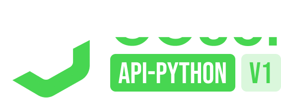

**ENG:**

py-GGSel API is a low-level library that provides a convenient interface for interacting with the GGsel API through a set of methods.

The library is designed using object-oriented programming (OOP) principles, which ensures flexibility, extensibility, and ease of integration into various projects.

Currently, py-GGSel API is in the early stages of development, so the functionality may change, and some features may be limited.

py-GGSel is based on the official GGSel API and its documentation — https://seller.ggsel.com/docs/seller-api-v-1

---

**RU:**

py-GGSel API — это низкоуровневая библиотека, предоставляющая удобный интерфейс для взаимодействия с API GGsel через набор методов.

Библиотека разработана с использованием принципов объектно-ориентированного программирования (ООП), что обеспечивает гибкость, расширяемость и удобство интеграции в различные проекты.

В настоящее время py-GGSel API находится на ранней стадии разработки, поэтому функциональность может изменяться, а некоторые возможности — быть ограниченными.

py-GGSel основан на GGSel API и его документации — https://seller.ggsel.com/docs

---

You can find all the available API methods in the official GGSel API documentation.

To call a specific method from the documentation, you can follow these steps: First, create an API instance (`GgselApiV1`), then select a category (API instance argument), and finally call the desired method (the method names are almost identical to those in the documentation).

```python
from ggsel_py.api.ggsel_api import GgselApiV1
from ggsel_py.schemas.v1.balance_object import BalanceObject

TOKEN = "YOUR TOKEN"  # Method for get token — https://seller.ggsel.com/docs/return-seller-token

api_obj = GgselApiV1(TOKEN)

api_account_category = api_obj.account  # Choosing a category
balance_info: BalanceObject = api_account_category.seller_balance_info()
```

### Async client and both API versions

`GgselApiMaster` works with V1 (token) and V2 (API key) at the same time. With `AsyncGClient` every method returns a coroutine.

```python
import asyncio

from ggsel_py import GgselApiMaster, AsyncGClient


async def main():
    api = GgselApiMaster(api_key="API KEY", token="TOKEN", client=AsyncGClient())

    chats = await api.api_v1.chats.list_chats(filter_new=True)
    offer = await api.api_v2.offers.get_offer(id=123)


asyncio.run(main())
```

### Project structure

- `ggsel_py/api/client.py` — HTTP clients (`SyncGClient`, `AsyncGClient`) and the request limiter `ApiLimiter`.
- `ggsel_py/api/category.py` — `@endpoint`: an API method is described once, as a function that builds the request;
  the same description works in `Category` (sync) and `AsyncCategory` (async) classes.
- `ggsel_py/api/v1`, `ggsel_py/api/v2` — the endpoints, one file per group of the documentation.
- `ggsel_py/api/ggsel_api.py` — `GgselApiV1`, `GgselApiV2`, `GgselApiMaster`.
- `ggsel_py/parameters` — enums and dataclasses for request arguments and bodies.
- `ggsel_py/schemas` — dataclasses of API responses; `ggsel_py/tools/handlers.py` turns responses into them.

Adding a method is one function in the group's file:

```python
@endpoint(OfferObject)
def get_offer(self, id: int, locale: Locale | str = "ru") -> RequestSpec:
    return build_request(EnumCrudMethod.GET, f"offers/{id}", headers=locale_header(locale))
```

